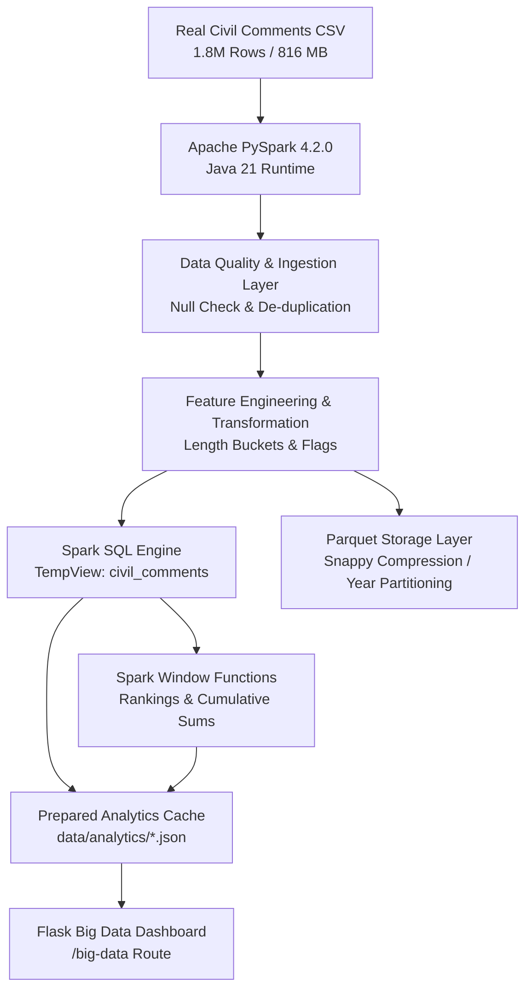

# Big Data Analytics Report: Real Civil Comments Architecture

## 1. Real Dataset Source & Scale
- **Dataset**: Jigsaw / Conversation AI Civil Comments Public Dataset (`civil_comments_train.csv`)
- **Total Scale**: **1,804,874** rows (778.40 MB)
- **Cleaned Dataset Scale**: **1,804,874** rows
- **Schema Attributes**: Continuous toxicity target `target` in [0, 1], subtype scores (`severe_toxicity`, `obscene`, `identity_attack`, `insult`, `threat`, `sexual_explicit`), timestamps (`created_date`), publication metadata (`publication_id`, `article_id`), community reaction metrics (`likes`, `disagree`, `funny`, `wow`, `sad`).

> [!IMPORTANT]
> **Dataset Distinction Note**: Civil Comments is a real-world toxicity dataset used as supplementary data and for large-scale Big Data analytics. The project's original dataset remains the domain-specific cyberbullying-labelled dataset.

## 2. Distributed Big Data Architecture

## 3. Spark DataFrames & Transformations
The pipeline constructs resilient Spark DataFrames utilizing:
- `comment_length` calculation and multi-class categorization into Short, Medium, Long, and Very Long groups.
- Strict binary toxicity flags (`is_toxic`, `is_insult`, `is_threat`, `is_obscene`, `is_severe_toxic`, `is_identity_attack`, `is_sexual_explicit`) based on human annotator agreement threshold >= 0.5.
- Timestamp parsing into `year`, `month`, `day`, and ISO `year_month` formatting for longitudinal time-series analytics.

## 4. Spark SQL Implementation
Spark SQL temporary view `civil_comments` was leveraged for high-performance distributed queries:
- **Total Real Comments**: 1,804,874
- **Toxic Comments**: 144,334 (8.0%)
- **Non-Toxic Comments**: 1,660,540 (92.00%)
- **Average Toxicity**: 0.103
- **Score Range**: Min 0.0 to Max 1.0

## 5. Advanced Window Functions
- **Publication Ranking**: Utilized `dense_rank().over(Window.orderBy(col("total_comments").desc()))` and `dense_rank().over(Window.orderBy(col("toxicity_rate_pct").desc()))` to identify high-volume and high-risk publications.
- **Cumulative Longitudinal Growth**: Utilized `sum().over(Window.orderBy("year_month").rowsBetween(Window.unboundedPreceding, Window.currentRow))` to track cumulative toxic volume over time.
- **Subtype Ranking**: Utilized `rank().over(Window.orderBy(col("count").desc()))` demonstrating that **Insult** (#1, 106,534 instances) is the dominant subtype, followed by **Obscene** and **Identity Attack**.

## 6. Parquet Compression & I/O Performance
- Processed data is stored at `data/parquet/civil_comments/` partitioned by `year` with Snappy compression.
- **CSV Size**: 778.40 MB
- **Parquet Size**: 41.83 MB (94.6% space savings)
- **Parquet Read Time**: 1.015 s vs CSV Read Time: 18.167 s

## 7. Real Data Limitations & Absence of Fabricated Dimensions
- Demographic fields such as user city, user country, user age, and specific social media platform were **NOT fabricated**.
- The existing dashboard retains `cyberbullying_dummy_dataset.csv` for platform-specific mock exploration, while the Big Data Dashboard strictly surfaces genuine Civil Comments dimensions.
- Real timestamps (`created_date`) are present in the dataset and provide genuine longitudinal trends spanning 2015 to 2018.

## 8. Web Integration & Decoupled Serving
- Flask route `@app.route('/big-data')` serves prepared analytics from `data/analytics/` without launching heavy 2M-row Spark jobs on every request.
- The existing ML pipeline (`best_model.pkl`, `best_vectorizer.pkl`) and pages (`/`, `/manual`, `/dashboard`, `/moderation`, `/simulation`) remain decoupled and untouched.
