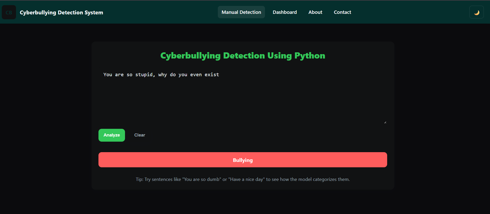
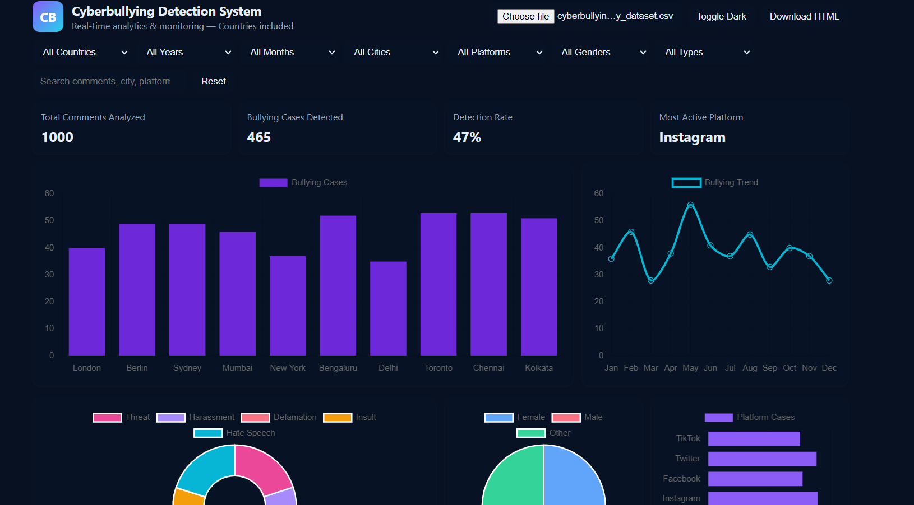
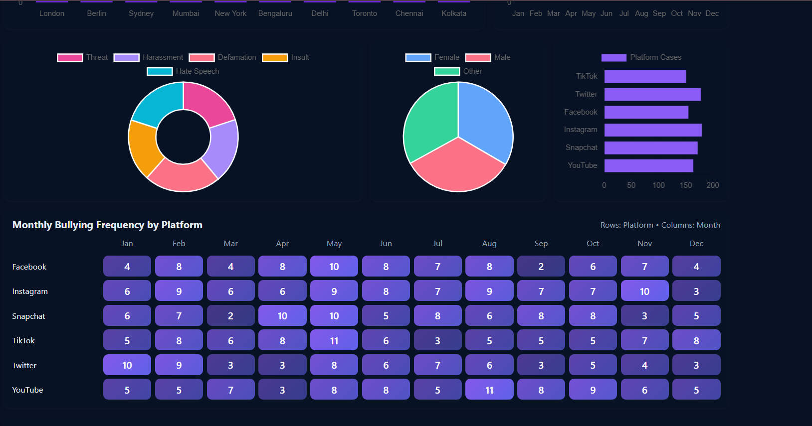
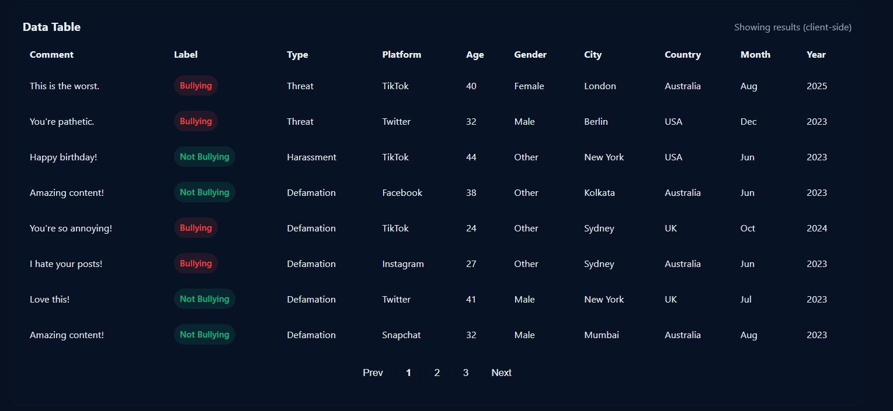

# 🛡️ Cyberbullying Detection System (AI)

An AI-based system to detect cyberbullying in text using Machine Learning.  
The application provides real-time prediction and an interactive analytics dashboard.

---

## 🔹 Features
- Real-time cyberbullying detection
- ML-based text classification
- Interactive dashboard & data table
- Platform, location & trend analysis

---

## 🧠 AI / ML Used
- TF-IDF text vectorization  
- Logistic Regression  
- Linear SVC  
- Decision Tree  

---

## 🛠 Tech Stack
Python • Flask • scikit-learn • Pandas • HTML • CSS • JavaScript

---

How to run (comments only):
Go to project folder  
Install required libraries  
Run python app.py  
Open http://127.0.0.1:5000  

---

## 📸 Screenshots

  
  
  
  

---

Developed by **Sajiya Shaikh**
