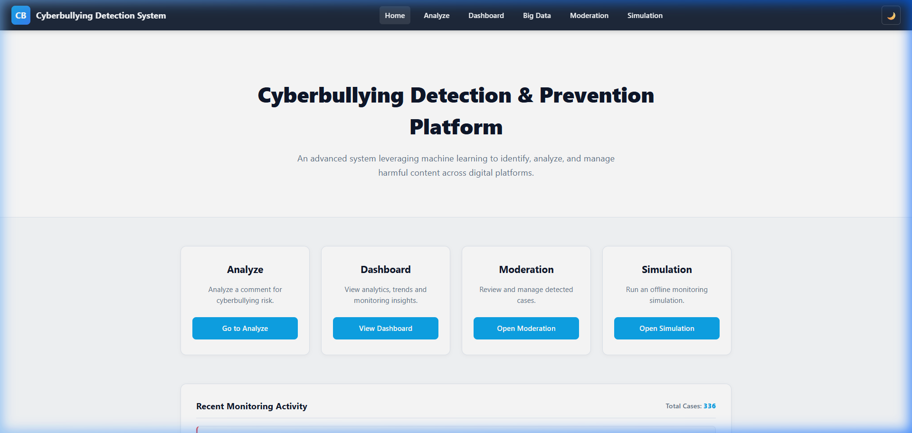
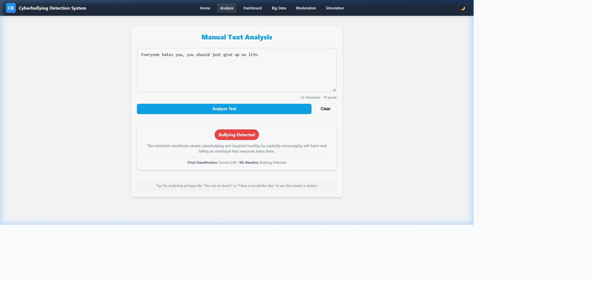
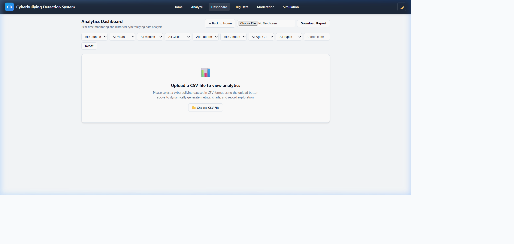
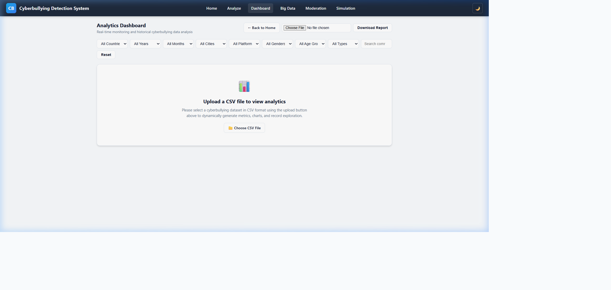
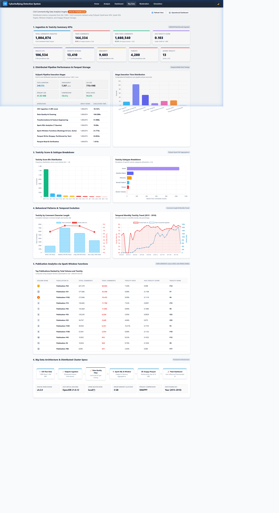
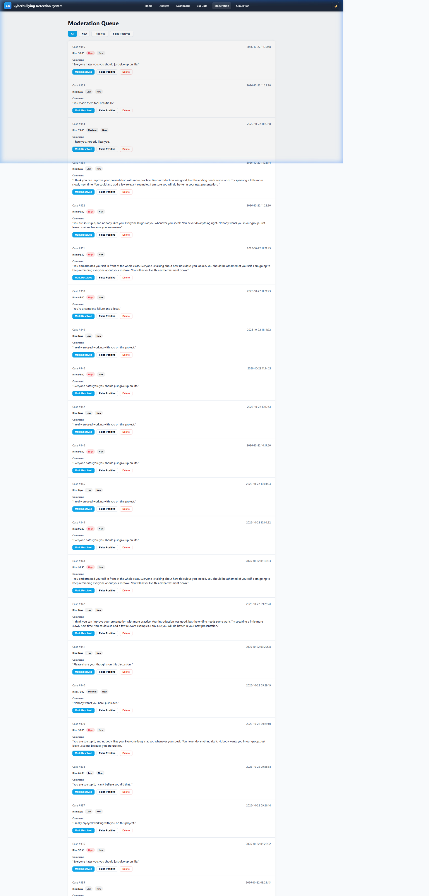
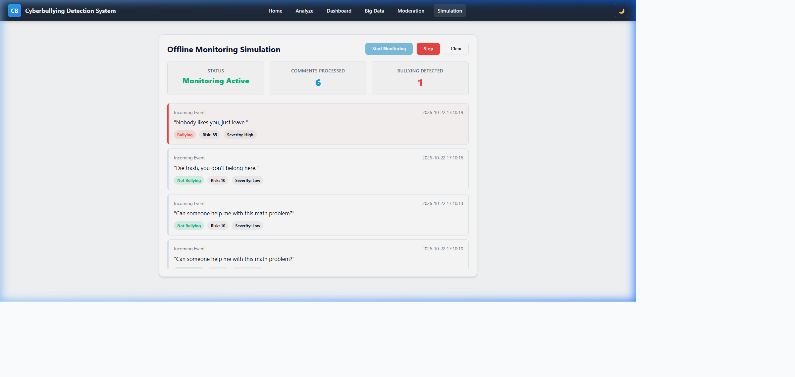

# CyberShield AI — Cyberbullying Detection and Big Data Analytics System

CyberShield AI is an intelligent, full-stack cyberbullying detection, content moderation, and large-scale data engineering platform. The system bridges real-time contextual natural language understanding with large-scale distributed analytics, combining Google Gemini LLM reasoning, an optimized linear ML baseline (TF-IDF + SGDClassifier), an interactive CSV-driven analytics dashboard, and an Apache PySpark big data analytics engine.

---

## 📸 Application Screenshots

### 1. Home Page


### 2. Context-Aware Text Analysis (Gemini LLM + ML Baseline)


### 3. Analytics Dashboard (Initial State — Awaiting CSV Upload)


### 4. Analytics Dashboard (Active State — Dynamic CSV Analytics)


### 5. Big Data Analytics Pipeline (1.8M Records Ingested via PySpark)


### 6. Moderation Queue & Case Workflow


### 7. Real-Time Comment Stream Simulation


---

## 📌 Problem Statement & Overview

Cyberbullying across digital platforms and online communities causes severe psychological and emotional harm. Traditional rule-based and keyword-matching systems suffer from high false-positive rates (e.g., misclassifying gaming dialogue or friendly banter) and false negatives (e.g., failing to identify subtle harassment, social ostracization, or veiled threats).

**CyberShield AI solves these challenges by combining:**
1. **Low-Latency Hybrid NLP Classification**: Real-time contextual classification leveraging Google Gemini Flash LLM as the final authority, backed by an optimized SGDClassifier baseline and graceful fallback.
2. **Dynamic CSV-Driven Dashboard**: Interactive multi-dimensional visualization of cyberbullying trends across platforms, cities, age groups, genders, and temporal windows (2020 through September 2026).
3. **Enterprise Big Data Analytics Pipeline**: Distributed Apache Spark (PySpark) pipeline handling 1.8M+ toxic and civil comment records with snappy-compressed columnar Parquet partitions and windowed analytical queries.
4. **Moderation & Live Simulation**: Active queue management for human-in-the-loop compliance review and asynchronous streaming simulation.

---

## 🚀 Key Implemented Features

### 1. Context-Aware Text Analysis (`/manual`)
- **Dual Engine Architecture**: Combines local linear ML inference (~2 ms) with Gemini LLM contextual classification (~1 s).
- **Gemini LLM Final Authority**: Uses the Google Gemini API to examine deep context, intent, sarcasm, and interpersonal hostility.
- **Fail-Safe Fallback**: If Gemini API quota is exhausted or network is interrupted, seamlessly falls back to the local `SGDClassifier` pipeline with clear user notification.
- **Explainability**: Returns genuine rationale detailing why a comment was categorized as hostile or benign.

### 2. CSV-Driven Analytics Dashboard (`/dashboard`)
- **Strictly Upload-Driven**: The dashboard starts in a clean waiting state, displaying zero fabricated or hardcoded demo metrics.
- **Dynamic File Parsing**: Accepts any valid cyberbullying dataset CSV (such as `cyberbullying_dashboard_dataset.csv` or `cyberbullying_dummy_dataset.csv`).
- **Dynamic Dimensions & Filters**:
  - **Country**: Multi-country geographic filtering.
  - **Year**: Dynamic multi-year filtering from **2020 through September 2026** (honestly bounded at September 30, 2026).
  - **Month**: Calendar-ordered month filtering with dual abbreviation/full-name normalization.
  - **City & Platform**: 46 cities and 9 major social platforms (YouTube, Facebook, Discord, Twitter, Instagram, Reddit, TikTok, Snapchat, WhatsApp).
  - **Demographics**: Gender and 6 distinct age groups (`13-17`, `18-24`, `25-34`, `35-44`, `45-54`, `55+`).
  - **Type & Search**: Classification type filter and real-time substring search.
- **Dynamic Visualizations**: Cases by City (Top 12), 12-Month Bullying Trend, By Type Doughnut, Gender Breakdown Pie, Age Group Bar Chart, Platform Horizontal Bar, and Monthly Frequency Heatmap.
- **Client-Side HTML Report Export**: The "Download Report" button captures the live active DOM and Chart.js canvases as embedded base64 PNG images, generating a standalone, offline `dashboard_report.html` reflecting the exact uploaded dataset and active filters.

### 3. Big Data Analytics Engine (`/big-data`)
- **Scalable Ingestion**: Processes over **1.8 million records** (778.4 MB) from the Civil Comments benchmark dataset.
- **Storage Optimization**: Columnar partitioned Parquet storage with Snappy compression, shrinking raw storage footprint from **778.4 MB down to ~41.8 MB** (an **18.6x compression ratio** and 94.6% disk space savings).
- **Analytical Metrics**: Precomputed analytics covering toxicity score distribution, toxicity subtypes (severe toxicity, obscene, threat, insult, identity attack), temporal longitudinal patterns, comment length correlations, and author publication volume.
- **Spark SQL Window Functions**: Computes cumulative windowed toxicity trends over time without full-table re-scans.

### 4. Moderation Queue & Offline Simulation
- **Moderation Workflow (`/moderation`)**: Persistent SQLite database (`platform.db`) tracking flagged cases with status controls (`New`, `Resolved`, `False Positive`).
- **Live Stream Simulation (`/simulation`)**: Client-side async streaming event simulator testing throughput, risk detection, and automated alert triggering.

---

## 🏗️ System Architecture

```
                                  [ User Interface ]
                 (Flask HTML5 Templates + Vanilla CSS + Chart.js)
                                         |
                  +----------------------+----------------------+
                  |                                             |
                  v                                             v
        [ Real-Time Inference ]                       [ Analytics & Ingestion ]
    +-----------------------------+               +-----------------------------+
    |  /manual & /api/analyze-    |               |  /dashboard (CSV Parsing)   |
    |  context                    |               |  PapaParse (In-Browser)     |
    +-----------------------------+               +-----------------------------+
                  |                                             |
         +--------+--------+                                    v
         |                 |                           [ Dynamic Visuals ]
         v                 v                           - KPI Metrics
   [ Local ML Engine ]   [ Gemini LLM API ]            - 6 Interactive Charts
   - TF-IDF Vectorizer   - Google GenAI SDK            - Platform Heatmap
   - SGDClassifier       - Gemini Flash Lite           - Standalone HTML Report
   - ~2ms Latency        - Final Authority
         |                 |
         +--------+--------+
                  |
                  v
       [ Hybrid Analysis Result ]
      (Prediction + Contextual Reason)
                  |
                  v
       [ Moderation DB (SQLite) ]
                                
  ================== BIG DATA OFFLINE PIPELINE ==================
  [ Raw Civil Comments CSV (778 MB) ]
                  |
                  v  (PySpark / Spark SQL in local[*] mode)
  [ Snappy-Compressed Parquet Partitions (data/parquet/, ~41.8 MB) ]
                  |
                  v  (Window Functions & Aggregation)
  [ Analytics JSON Marts (data/analytics/*.json) ] ---> Served at /big-data
```

---

## 🛠️ Technology Stack

| Layer | Technologies Used |
| :--- | :--- |
| **Backend Framework** | Python 3.11, Flask 2.3+ |
| **LLM Reasoning** | Google GenAI SDK (`google-genai`), Gemini 3.5 Flash Lite (`gemini-3.5-flash-lite`), Gemini 3.5 Flash fallback |
| **Machine Learning** | Scikit-learn, TF-IDF Vectorization (Word & Char n-grams), SGDClassifier |
| **Big Data Processing** | Apache Spark 3.5, PySpark, Spark SQL, Window Functions |
| **Data Storage** | Apache Parquet (Snappy-compressed), SQLite (`platform.db`), CSV |
| **Frontend & UI** | Semantic HTML5, Vanilla CSS3 (Custom Dark/Light Theme System), Chart.js 4.4, PapaParse 5.4 |
| **Testing** | Pytest, Python Unittest |

---

## 🧠 Machine Learning & LLM Integration Architecture

### Gemini LLM Integration
- **Role**: Serves as the **final classification authority** whenever the API is available.
- **Model Strategy**: Uses `gemini-3.5-flash-lite` as the primary low-latency model (~0.88s – 1.05s response time), with `gemini-3.5-flash` as a single bounded fallback. Extended reasoning/thinking models (`gemini-3.7-flash`) are bypassed to prevent 40+ second latencies.
- **Contextual Awareness**: Prompted with rigorous evaluation guidelines to differentiate sarcasm, competitive video game expressions (e.g., *"we destroyed the enemy team"*), movie critiques, and friendly banter from targeted personal harassment.

### ML Baseline & Fallback
- **Vectorization**: Sublinear TF-IDF extracting word n-grams (1–2) and character n-grams (3–5).
- **Classifier**: `SGDClassifier` calibrated with modified Huber loss for probabilistic boundary outputs.
- **Preserved Production Models**: Active candidate model located in `models/model_improvement/candidate_model.pkl` and `candidate_vectorizer.pkl`.
- **Honest Fallback**: If LLM connectivity is lost, the application falls back transparently to the SGDClassifier baseline and explicitly labels the output as `ML_FALLBACK`.

---

## 📊 Big Data Analytics Pipeline (PySpark)

- **Execution Mode**: Runs locally via PySpark using `local[*]` to utilize all available CPU cores.
- **Source Dataset**: Raw Civil Comments benchmark dataset (1,804,874 records, 778.4 MB).
- **Pipeline Implementation**: Located in [`big_data/pipeline.py`](big_data/pipeline.py).
- **Core Operations**:
  - Schema casting and null imputation.
  - Columnar transformation and Snappy-compressed Parquet partitioning by year (`year=2015` through `year=2017`).
  - Toxicity decile distribution analysis.
  - Identity subtype correlation analysis (severe toxicity, obscenity, threats, insults).
  - Multi-year longitudinal window functions:
    ```python
    window_spec = Window.partitionBy("publication_year").orderBy("publication_month")
    ```
  - Materialization of precomputed JSON data marts (`data/analytics/*.json`) for instant, sub-millisecond Flask dashboard rendering.

---

## 📁 Dataset Descriptions & Roles

| Dataset File | Size | Records | Role in Project |
| :--- | :--- | :--- | :--- |
| `cyberbullying_dashboard_dataset.csv` | ~1.38 MB | 10,000 | Primary evaluation dataset for the Analytics Dashboard, covering 2020 through Sep 2026 across 10 countries and 9 platforms. |
| `cyberbullying_dummy_dataset.csv` | ~81 KB | 1,000 | Lightweight mock dataset covering 2023–2025 used for testing alternative schema uploads. |
| `dataset.csv` / `cyberbullying_data.csv` | ~4.9 MB | ~47,000 | Core multi-class training and validation datasets for offline model development. |
| `instagram_comments.csv` | ~78.9 MB | ~235,000 | Social media comment validation corpus. |
| `civil_comments_train.csv` | ~778.4 MB | 1,804,874 | Massive toxicity dataset used for the Big Data pipeline. *(Excluded from git tracking due to GitHub's 100MB limit; precomputed Parquet and JSON files are provided).* |

---

## 📂 Project Directory Structure

```
cyberbullying_detection/
├── app.py                                # Flask web application main entrypoint
├── llm_analyzer.py                       # Gemini LLM analyzer & hybrid ML pipeline
├── requirements.txt                      # Project dependency specification
├── .env.example                          # Environment variable template
├── .gitignore                            # Git exclusion rules (secrets, big files)
├── README.md                             # Comprehensive project documentation
├── test_system_regression.py             # 18-suite end-to-end regression tests
│
├── big_data/                             # Distributed Big Data Pipeline
│   └── pipeline.py                       # PySpark pipeline (Parquet + Spark SQL)
│
├── data/                                 # Data Assets & Analytics Marts
│   ├── analytics/                        # Precomputed JSON analytics marts
│   │   ├── benchmarks.json
│   │   ├── length_analysis.json
│   │   ├── overview.json
│   │   ├── publication_analysis.json
│   │   ├── quality_report.json
│   │   ├── score_distribution.json
│   │   ├── subtypes.json
│   │   └── temporal_trends.json
│   ├── parquet/                          # Columnar Snappy-compressed Parquet partitions
│   │   └── civil_comments/
│   │       ├── year=2015/
│   │       ├── year=2016/
│   │       └── year=2017/
│   └── cyberbullying_dashboard_dataset.csv # Persistent copy of dashboard dataset
│
├── docs/                                 # Documentation & Assets
│   └── screenshots/                      # Application screenshots referenced in README
│       ├── 01_home_page.png
│       ├── 02_manual_analysis.png
│       ├── 03_dashboard_initial.png
│       ├── 04_dashboard_active.png
│       ├── 05_big_data_analytics.png
│       ├── 06_moderation_queue.png
│       └── 07_live_simulation.png
│
├── models/                               # Machine Learning Model Artifacts
│   └── model_improvement/
│       ├── candidate_model.pkl           # Calibrated SGDClassifier model
│       └── candidate_vectorizer.pkl      # FeatureUnion TF-IDF vectorizer
│
├── templates/                            # Flask HTML5 Templates
│   ├── base.html                         # Base template with theme system
│   ├── index.html                        # Application landing page
│   ├── manual.html                       # Real-time text analysis UI
│   ├── dashboard.html                    # Dynamic CSV-driven analytics dashboard
│   ├── big_data.html                     # Big Data PySpark analytics view
│   ├── moderation.html                   # Active case moderation queue
│   └── simulation.html                   # Live comment stream simulation
│
└── static/                               # Static Web Assets
    └── css/
        └── style.css                     # Global stylesheet
```

---

## ⚡ Getting Started & Installation

### Prerequisites
- Python 3.10 or 3.11
- Java 8 or 11 (required only if running the PySpark pipeline locally)
- A Google Gemini API key ([Get an API Key](https://aistudio.google.com/))

### 1. Clone the Repository
```bash
git clone https://github.com/Shaziya-1/Cyber-Bullying-Detection-System.git
cd Cyber-Bullying-Detection-System
```

### 2. Set Up a Virtual Environment
```bash
# Windows
python -m venv venv
venv\Scripts\activate

# Linux / macOS
python3 -m venv venv
source venv/bin/activate
```

### 3. Install Dependencies
```bash
pip install -r requirements.txt
```

### 4. Configure Environment Variables
Copy `.env.example` to `.env` and insert your Gemini API key:
```bash
cp .env.example .env
```
Edit `.env`:
```ini
GEMINI_API_KEY=your_actual_gemini_api_key_here
```

---

## 🖥️ Running the Application

### 1. Start the Flask Server
```bash
python app.py
```
Open your browser and navigate to:
```
http://127.0.0.1:5000/
```

### 2. Running the Big Data Analytics Pipeline (Optional)
The precomputed Parquet partitions and JSON analytics marts are already included in `data/`, so the `/big-data` dashboard works immediately. To re-run the pipeline on raw data:
```bash
python big_data/pipeline.py
```

### 3. Running Automated Regression Tests
To run the complete test suite verifying ML predictions, LLM integration, and Big Data routes:
```bash
python -m pytest test_system_regression.py -v
```
All 18 tests will execute in ~8 seconds:
```
test_system_regression.py::TestCyberbullyingFix::... PASSED
test_system_regression.py::TestLLMContextualAnalysis::... PASSED
test_system_regression.py::TestBigDataAnalyticsVerification::... PASSED
============================= 18 passed in 8.79s =============================
```

---

## 🛡️ Limitations & Future Improvements

- **Multilingual Support**: Future iterations can expand the local ML baseline to support code-mixed and non-English text (e.g., Hinglish, Arabic, Spanish).
- **Cluster Deployment**: The PySpark pipeline currently operates in standalone `local[*]` mode. Future scaling can deploy to a distributed Apache Spark cluster on Dataproc, EMR, or Kubernetes.
- **Multimodal Toxicity**: Extending detection from text-only to multimodal analysis (images, memes, and video streams) using Gemini vision capabilities.

---

## 📄 License
This project is developed for educational, academic, and research purposes in cyberbullying detection, computational safety, and scalable big data analytics.
